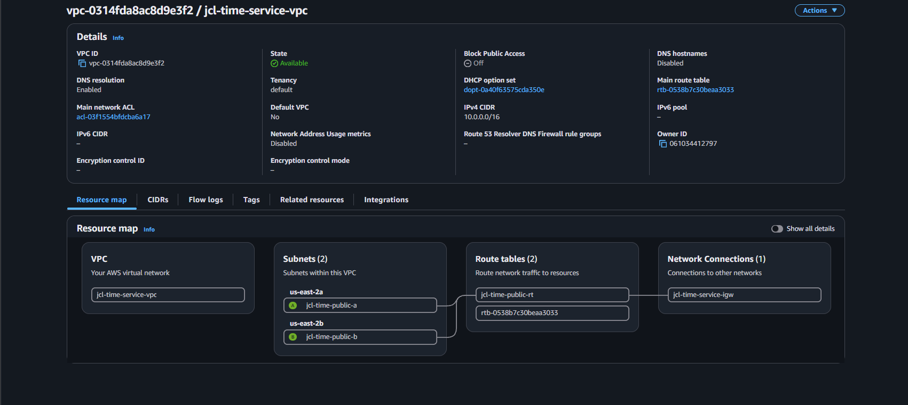
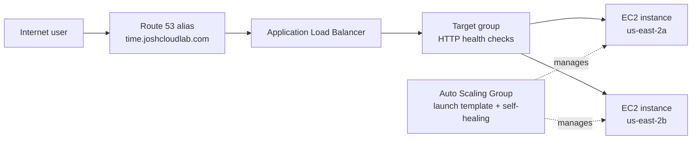
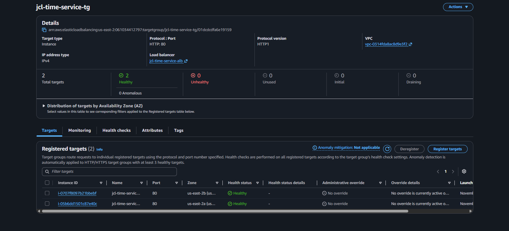
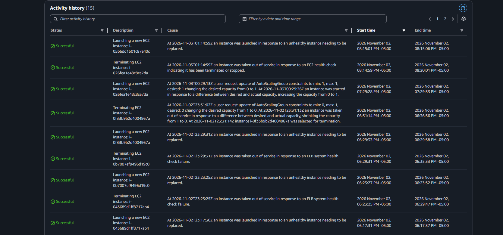
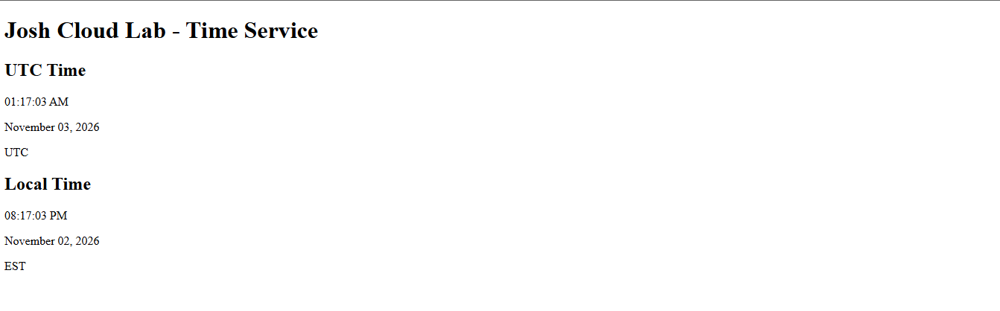

# AWS Time Service

> A highly available Flask application deployed on AWS with custom networking, load balancing, DNS, and EC2 Auto Scaling.

> **Deployment status:** The AWS environment has been dismantled to avoid ongoing infrastructure costs. The architecture, deployment configuration, and validation evidence remain documented here. The URL below is retained as a reference to the original deployment and is not currently available.

**Original application URL:** [time.joshcloudlab.com](http://time.joshcloudlab.com) *(environment dismantled)*

## Project Overview

I built this project to apply AWS Solutions Architect concepts in a working environment rather than only following console walkthroughs. The application is intentionally small so the infrastructure, traffic flow, health checks, and recovery behavior are easy to observe.

The service displays:

- Current UTC time, date, and time zone
- Current U.S. Eastern time, date, and time zone

The Flask application was deployed to EC2 instances managed by an Auto Scaling Group. An internet-facing Application Load Balancer distributed traffic across instances in two Availability Zones, while Route 53 provided a stable public DNS name.

## Architecture





### Network Design

The environment is deployed in **AWS us-east-2 (Ohio)**:

| Component | Configuration |
| --- | --- |
| VPC | `10.0.0.0/16` |
| Public subnet A | `10.0.1.0/24` in `us-east-2a` |
| Public subnet B | `10.0.2.0/24` in `us-east-2b` |
| Internet Gateway | Provides internet connectivity |
| Public route table | Routes `0.0.0.0/0` to the Internet Gateway |
| Load balancer | Internet-facing across both Availability Zones |

## AWS Services and Responsibilities

| Service | How it was used |
| --- | --- |
| Amazon VPC | Created the isolated network, subnets, route table, and Internet Gateway |
| Amazon EC2 | Hosted the Flask application |
| EC2 Launch Template | Defined repeatable instance configuration |
| EC2 Auto Scaling | Maintained capacity and replaced unhealthy or terminated instances |
| Application Load Balancer | Accepted public HTTP traffic and distributed requests |
| Target Group | Registered EC2 instances and performed HTTP health checks |
| Amazon Route 53 | Mapped the custom domain to the load balancer with an alias record |
| IAM | Provided permissions through an EC2 instance role |
| Security Groups | Segmented internet-to-ALB and ALB-to-EC2 traffic |

## Security and Traffic Flow

The load balancer and application instances use separate security groups:

```text
Internet
   |
   | HTTP :80
   v
ALB security group
   |
   | HTTP :80 (only from the ALB security group)
   v
EC2 application security group
```

This keeps the EC2 application tier from accepting arbitrary inbound HTTP traffic directly from the internet.

## Validation and Troubleshooting

I validated the deployment through the following scenarios:

- Flask application started successfully on EC2
- Route 53 alias resolved to the Application Load Balancer
- Target group health checks passed
- Two healthy targets operated across `us-east-2a` and `us-east-2b`
- A manually terminated instance was automatically replaced by the Auto Scaling Group
- The public URL remained available through instance replacement



### Self-Healing Test

To test recovery, I manually terminated a running EC2 instance. The Auto Scaling Group detected that actual capacity had fallen below the desired capacity and launched a replacement from the launch template. The replacement instance then:

1. Booted with the required network configuration
2. Registered with the target group
3. Passed the Application Load Balancer health check
4. Began serving application traffic



### Troubleshooting Experience

During the deployment, instances passed EC2 system checks but failed Application Load Balancer health checks. Because ELB health checks were enabled for the Auto Scaling Group, the unhealthy instances were repeatedly removed and replaced.

I traced the issue to the launch template's network configuration, created a corrected template version, and verified that the target group and Auto Scaling Group stabilized. This reinforced the difference between:

- EC2 infrastructure health
- Application-level load balancer health
- Auto Scaling replacement behavior

## Application

The application is a lightweight Flask service using Python's standard `datetime`, `timezone`, and `zoneinfo` libraries:

```text
.
├── app.py
├── requirements.txt
├── templates/
│   └── index.html
└── docs/
    └── screenshots/
```



Run locally with:

```bash
python3 -m venv .venv
source .venv/bin/activate
pip install -r requirements.txt
flask --app app run
```

For a production-style process, the project includes Gunicorn:

```bash
gunicorn app:app
```

## What This Project Demonstrates

- Designing a custom VPC and public subnet layout
- Deploying application capacity across multiple Availability Zones
- Controlling traffic with security-group relationships
- Creating repeatable EC2 deployments with launch templates
- Connecting Route 53, an ALB, target groups, and EC2
- Using health checks to control traffic and instance replacement
- Testing self-healing behavior instead of assuming it works
- Troubleshooting an infrastructure health-check failure

## Project Context

This project was completed as a hands-on AWS exercise while studying for the AWS Solutions Architect certification. It demonstrates my ability to design, deploy, validate, and troubleshoot a cloud-hosted application using core AWS services. The environment has since been dismantled, but the implementation and validation evidence remain available for review.

## Repository

- [`app.py`](app.py) — Flask application logic and time-zone conversion
- [`templates/index.html`](templates/index.html) — HTML presentation layer
- [`requirements.txt`](requirements.txt) — Flask and Gunicorn dependencies
- [`docs/screenshots/`](docs/screenshots/) — Selected AWS deployment and validation evidence
